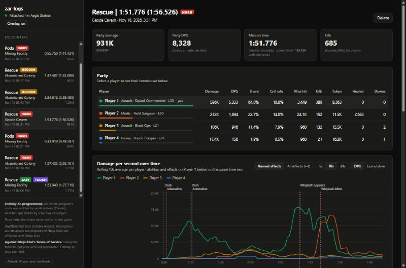
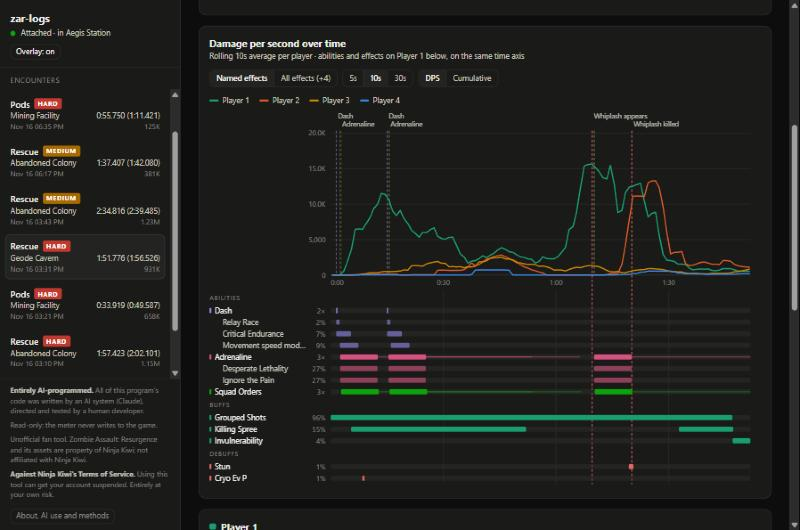
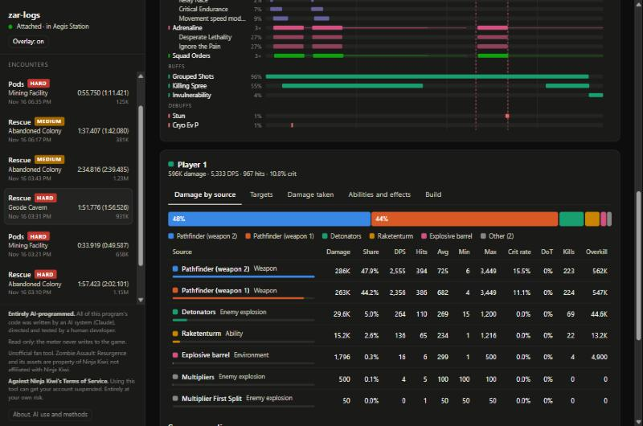
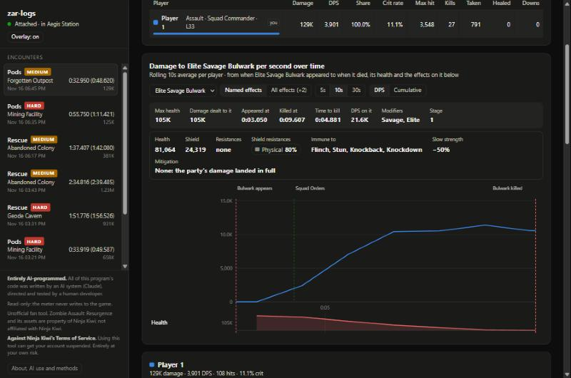
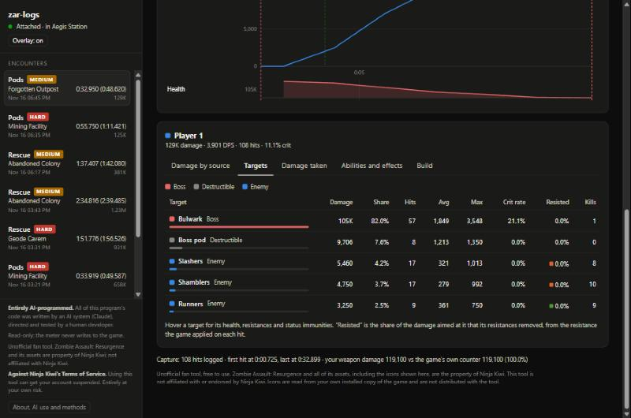
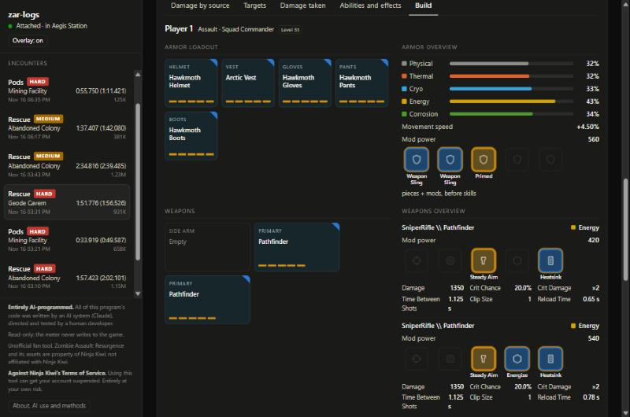

# zar-logs

A damage meter and build viewer for Zombie Assault: Resurgence, as a small desktop app for Windows (Rust + Tauri).
It records every mission you play: damage by player, by source and over time, healing, status effect uptime, what
each enemy resisted, and each player's build as the game's own cards show it.

> **AI disclosure**
> 
> **This application and its development process were entirely AI-programmed.**
> 
> If you are against AI-driven development, this software uses it plentifully. Take that as you will.
> 
> Treat numbers from this tool as programmatic reading of the game by a machine. These are not official figures. If something looks wrong, please reach out to me about it.
> 
> This will forever be free and open-source. Feel free to review the code (at potentially your own peril). Feel free to fork it, do analysis on it, verify any claims made about its security or features.
> 
> The initial research process, reverse engineering, UI and data programming, and documentation were 100% AI generated with Claude Fable 5.2.
> Initial research on the game was primarily focused on understanding RNG, how to predict it, and how to manipulate it. Since then I pivoted to the idea of a parser, as there have been plenty of complaints about in-game DPS numbers being misleading, and I wanted a concrete, verifiable source for actual DPS numbers
> 
> My role has been that of direction and playtesting. The development loop has been one of prompting -> AI development -> playtesting -> feedback.
> I only gave suggestions on what features I would appreciate, references I liked, and any discrepancies I identified with in-game data.
> I did NOT review the code in its entirety, and all testing has been manual feature testing through my own use of the tool when playing.
> 
> I don't personally know Rust development and don't work with too much Python, so any contributions are difficult for me to personally assess, but I will try and respond to feedback by continuing the above development cycle. I mean to maintain this over ZA:R updates and not be a throwaway project.
> 
> [METHODS.md](METHODS.md) is a fully AI-generated document detailing all research, reverse engineering, and development work that went into this, from the AI's "perspective". It's not a testament to my skill as a developer, but moreso that of current frontier AI models.
> 
> I personally hope the best for the future of this game, and hope to be able to contribute positively to its community through this tool, bug reports, and direct involvement and play.
> 
> If you have any concerns, criticism, feedback, bug reports, feature requests, etc, please create an issue or DM me on discord @vicplusplus. My DMs are open!
> 
> This is probably the only purely human-written section in the repo. I'm sorry if anything else is difficult to read, or what feels like slop to you. I focus on the utility of the program and the user experience directly more than the developer experience here.
> 
> \- vicplusplus

> **Unofficial.** A free fan tool. Zombie Assault: Resurgence and all of its assets are the property of Ninja Kiwi.
> This project is not affiliated with or endorsed by Ninja Kiwi, and Ninja Kiwi has not approved it. Using it is
> against Ninja Kiwi's Terms of Service and is entirely at your own risk (see "Is it safe?" below). No game asset
> is included in this repository or in a build: the pictures and texts the app shows are read from your own
> installed copy of the game.

## What it does

- **Records every mission on its own.** Start it, play, and each mission you finish or leave shows up in the list.
  Solo or co-op. The hub (Aegis Station) is not a mission and is not recorded.
- **Live overlay.** A small always-on-top panel with the party's DPS while you play. It never takes keyboard focus
  from the game, can be dragged anywhere, remembers where you put it, and can be switched off.
- **Damage for every player in the party**: total, DPS over the mission's time, share, crit rate, biggest hit and
  kills, and a chart of damage over time (DPS or cumulative), with the game's own mission timer next to it.
- **Where the damage came from**: by weapon, ability, deployable and other sources, for each player.
- **Who took it**: damage by enemy type, with each enemy's real health, shield and resistances, and how much of
  your damage it resisted.
- **Bosses**: portrait, defences, and the chart narrowed to that boss from the moment it appears until it dies.
- **Damage taken, healing, downs and health over time**, per player.
- **Abilities and status effects**: which abilities, buffs and debuffs were up and for how long, drawn as lanes
  under the chart.
- **Build viewer**: every player's weapons, mods, armour, deployables, abilities and skills as the game's own cards
  show them, with the numbers worked out for that exact loadout (damage, explosion damage, crit, clip, reload,
  mod power, resistances).
- **Mission details**: map, mode, difficulty, the Tough modifier, won / lost / left, kills.
- **Keeps up with game updates**: after an update it re-reads what it needs from your installed game by itself.
- **Everything stays on your computer.** No account, no upload, no internet connection.

### A closer look

| | |
|---|---|
|  |  |
| **Damage over time**, with every ability, buff and debuff on the same time axis. | **Where the damage came from**: each weapon, ability and other source, with hits, crits and overkill. |
|  |  |
| **Bosses**: health, shield, resistances, immunities and time to kill, with the chart narrowed to the fight. | **Who took it**, how much each enemy resisted, and a check against the game's own damage counter. |
|  | |
| **Build viewer**: armour, weapons, mods and the numbers they add up to. | |

These screenshots were taken with the game's pictures switched off, so that no game art is in this repository. In
the app you also see the weapon icons, enemy portraits and map pictures, read from your own install. The player
names are placeholders.

## Is it safe? Is it cheating?

**It only watches.** zar-logs reads what the game has already computed and shows it to you. It does not change
anything and cannot give you an advantage in play.

**It is still not permitted.** Ninja Kiwi's terms prohibit capturing data from their games without their written
consent, and using this tool can cost you your account. The details are under "Things you should know" below.

What it does:

- Runs as its own, separate program.
- Reads the running game's memory from outside. It asks Windows for read access only, so it is not able to write
  to the game even by mistake.
- Reads files of your installed game (never changes them) to learn names, numbers and pictures.
- Writes only its own files: your logs and a cache, in its own folder.

What it never does:

- No injection into the game, no hooks, no patching, no mods.
- No writing to the game's memory, its files, or your save.
- No keyboard or mouse input sent to the game. No automation.
- No network. It does not talk to the game's servers or to anyone else; it has no telemetry and no update check.
  The only connection is from its own window to itself (`127.0.0.1`). The few links on its About page open in
  your own browser, and only when you click them.
- No account details. It never asks for a login and does not store account ids.

You do not have to take this on trust: all of the code is in this repository, the part that touches the game is
one short file (`crates/core/src/proc.rs`), and [METHODS.md](METHODS.md) lists every technique and tool that was
used to make it, and the ones that were not.

Things you should know before deciding:

- **Using this tool is against Ninja Kiwi's Terms of Service.** Their [terms](https://ninjakiwi.com/terms) (last
  updated March 4, 2025) expressly prohibit, without Ninja Kiwi's written consent, any attempt to "datasniff, data
  capture" or scrape their games, in the same list as hacking, cheating and botting. zar-logs captures data from
  the running game and has no such consent. That it only reads, changes nothing and gives no advantage does not
  make it allowed. The terms say such use ends your licence to play and leads to your account being segregated or
  suspended, and that progress and purchases lost that way are not compensated. **Use of this tool is entirely at
  your own risk.** Read the terms yourself before you decide.
- **Logs contain names.** A recorded mission holds the display names and builds of everyone who was in it. They
  stay on your computer unless you share them.
- **Antivirus and Windows warnings.** The program is not signed, so Windows may warn the first time you run it,
  and some antivirus tools are wary of any program that reads another one's memory.

## Install

You need Windows 10 or 11 (64-bit) and the Steam version of Zombie Assault: Resurgence.

1. Download `zar-logs-setup.exe` from the [Releases](https://github.com/vicplusplus/zar-logs/releases) page and
   run it. If Windows shows "Windows protected your PC", choose "More info", then "Run anyway" (the installer is
   not signed).
2. It installs for your user only, needs no administrator rights, and adds a Start Menu entry. A desktop shortcut
   is a checkbox on the last page.
3. Start zar-logs, and start the game, before or after; the order does not matter.

The first start, and the first start after each game update, takes about ten seconds while it reads your installed
game. After that it opens two windows: the viewer and the overlay. Closing the viewer closes everything.

The overlay shows over a borderless or windowed game. Exclusive fullscreen hides every overlay of this kind.

The viewer uses the WebView2 runtime, which is part of Windows 11 and present on almost every Windows 10 PC. The
installer does not download it. If zar-logs does not open a window, install it from Microsoft ("WebView2 Runtime,
Evergreen").

To update, run the newer installer over the old one. Your logs and settings are kept.

**Portable version.** If you would rather not install anything, download `zar-logs-portable.zip` instead, unzip it
anywhere and run `zar-logs.exe`. It is the same program; it only lacks the shortcuts and the entry in Windows'
list of apps.

Prefer to build it yourself? See [CONTRIBUTING.md](CONTRIBUTING.md); it is one command.

## Settings

There is nothing you have to set. The overlay's on / off switch is in the viewer's sidebar, and its position is
saved when you drag it.

For the rest there is a small file, `config.json`, in the data folder
(`%LOCALAPPDATA%\com.vicplusplus.zar-logs`). Close zar-logs
before editing it.

| Setting | Key in `config.json` | Default |
|---|---|---|
| where recorded missions are kept | `"logs": "D:\\some\\folder"` | `%LOCALAPPDATA%\com.vicplusplus.zar-logs\logs` |
| where the cache of game data is kept | `"cache": "D:\\some\\folder"` | `%LOCALAPPDATA%\com.vicplusplus.zar-logs\cache` |
| port of the local page (your machine only) | `"port": 5175` | 5175, or any free port |
| overlay shown, and where | `"overlay"` (written by the app) | shown |

The game is found automatically: through the running game, or your Steam libraries on any drive. If it is
somewhere unusual, set the environment variable `ZAR_GAME_DIR` to the game's folder. The data folder itself can be
moved with the environment variable `ZARLOGS_DATA`.

To delete one recorded mission, open it in the viewer and press "Delete".

## Uninstall

**Installed version:** Windows Settings, Apps, Installed apps, zar-logs, Uninstall. The uninstaller has one checkbox, **"Delete the application data"**. Tick it to also delete your
recorded missions, settings and cache; leave it empty and they are still there if you install again.

**Portable version:** run `uninstall.cmd` from the folder you unzipped. It shows what it found and asks before each
step: remove the program, whether to also delete your recorded missions, whether to also delete settings and the
cache. It deletes only files zar-logs created.

By hand it comes to the same thing: everything zar-logs has stored is in one folder,
`%LOCALAPPDATA%\com.vicplusplus.zar-logs` (logs, settings, cache, and the window data Windows keeps for the viewer).

What zar-logs leaves on your PC: the installed version has its program folder (`%LOCALAPPDATA%\zar-logs`), its
shortcuts and the usual entry in Windows' list of installed apps, all removed by the uninstaller. The portable
version has only the folder you unzipped. Neither puts anything in the game's folder, starts with Windows, or runs
anything in the background when its window is closed.

## Something wrong?

Open an issue here (there is a template), or see the contact at the top of this page. The most useful report says
what the game showed and what zar-logs showed. For a wrong number: the weapon, its quality and level, and its mods.

The log of the mission helps a lot (`%LOCALAPPDATA%\com.vicplusplus.zar-logs\logs`), but remember it contains the display names
of everyone in that mission.

After a game update zar-logs re-reads everything from the new files. If something it needs has been renamed, it
says so in its status line instead of guessing. That is a bug to report, with the date of the update.

## Thanks

The idea came from [gbfr-logs](https://github.com/gbfr-logs/gbfr-logs), the damage meter for Granblue Fantasy:
Relink, and from Cleista's fork of it in particular: <https://relink.cleista.cc/en>. Many design choices and
quality-of-life features here were taken from that site. If you play Relink, go and look at it; it is a pretty
cool tool. No code was taken from it, and zar-logs works differently underneath (no injection).

## More

- [METHODS.md](METHODS.md): how the game's data was worked out, every tool used, and what was and was not done to
  the game.
- [CONTRIBUTING.md](CONTRIBUTING.md): building from source, how the program is put together, tests, known gaps.
- [THIRD-PARTY-NOTICES.md](THIRD-PARTY-NOTICES.md): licences of the projects used as references.

## License

[MIT](LICENSE). That covers this project's own code and documents. It does not cover Zombie Assault: Resurgence or
anything read from it, which remain Ninja Kiwi's.
